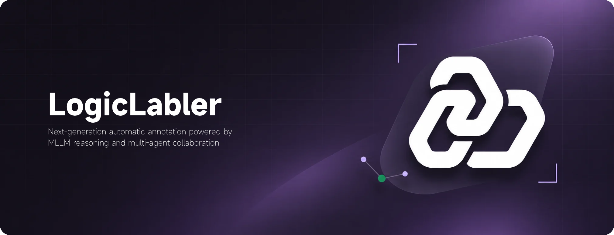
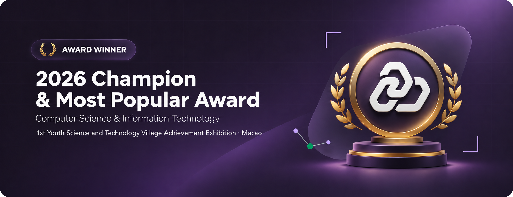
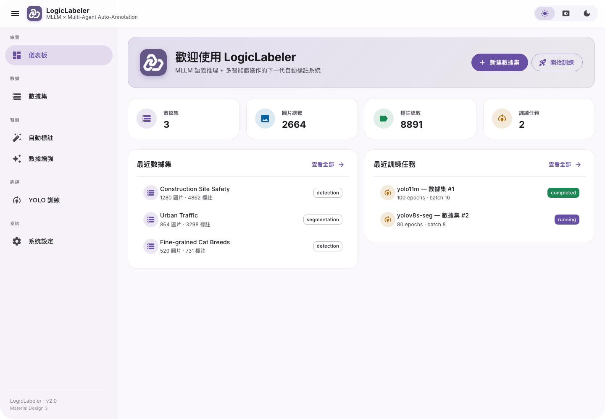
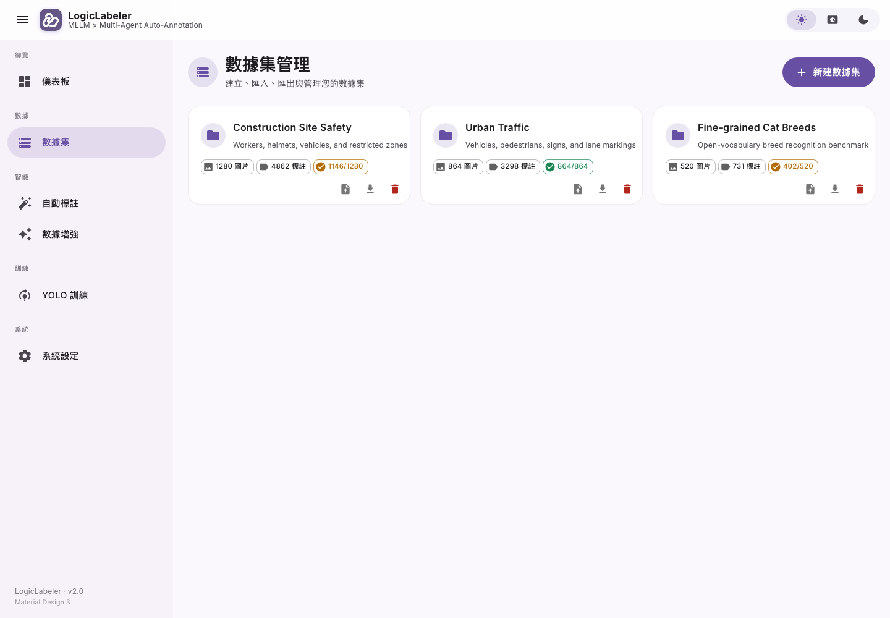
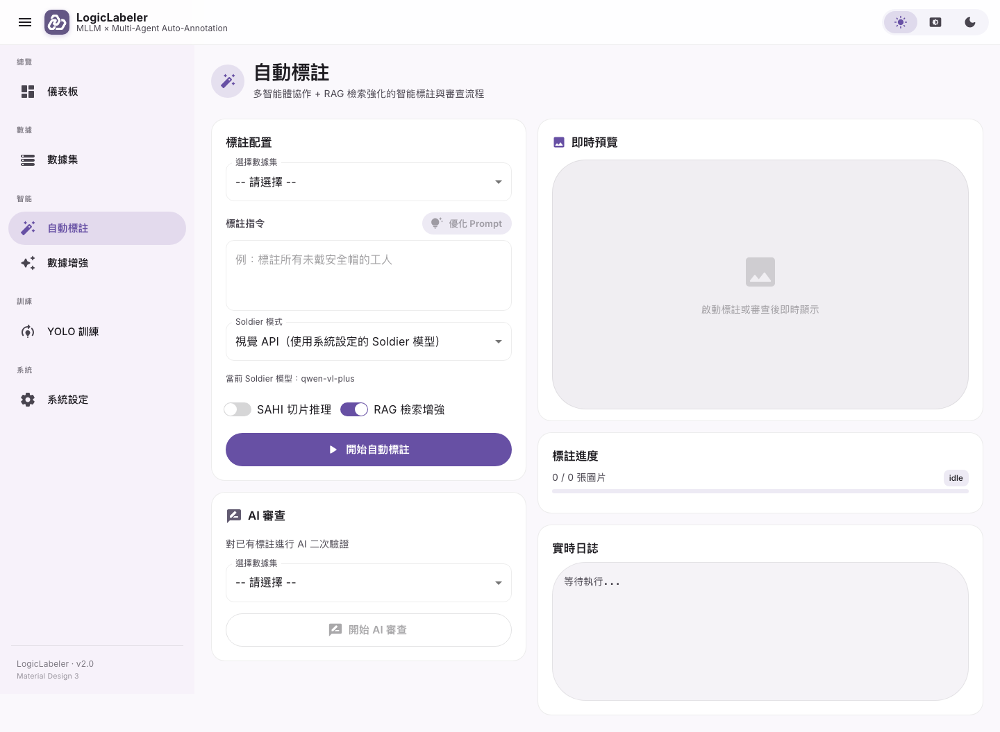
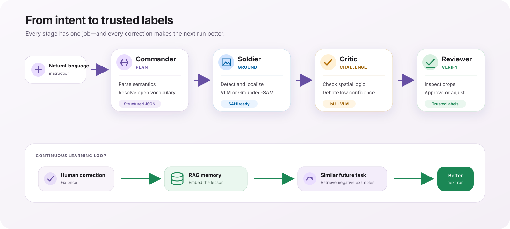
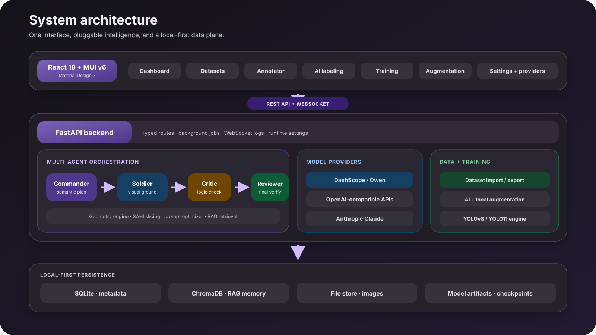
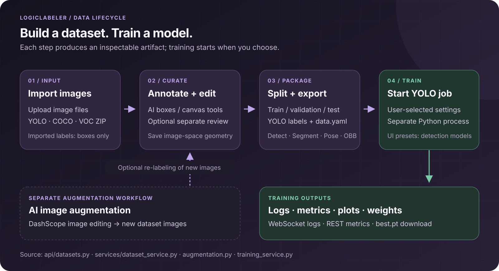

<div align="center">

**English** · [繁體中文](./README.zh-TW.md) · [简体中文](./README.zh-CN.md)


# LogicLabeler

**Next-generation automatic annotation powered by MLLM reasoning and multi-agent collaboration**

*Go beyond seeing objects—understand their relationships, attributes, and state.*

<br />



<br />


<a href="https://www.msc.org.mo/attachment/files/2026/06/18/第一屆“青年科技村科創人才培訓計劃”成果展得獎名單.pdf"></a>

<br /><br />

[Recognition](#recognition) · [Product preview](#product-preview) · [Pipeline](#multi-agent-annotation-pipeline) · [Architecture](#architecture) · [Data lifecycle](#from-images-to-model-artifacts) · [Quick start](#quick-start)

<br /><br />

| Traditional annotation | LogicLabeler |
|:---:|:---:|
| “Label every **worker**” | “Label every worker **not wearing a helmet**” |
| “Label every **truck**” | “Label every truck **currently unloading**” |
| “Label every **vehicle**” | “Label vehicles **parked in a restricted zone**” |

</div>

---

## Recognition

<a href="https://www.msc.org.mo/attachment/files/2026/06/18/第一屆“青年科技村科創人才培訓計劃”成果展得獎名單.pdf">
  
</a>

<p align="center"><sub>First “Youth Science and Technology Village” Scientific Innovation Talent Training Program Achievement Exhibition · <a href="https://www.msc.org.mo/attachment/files/2026/06/18/第一屆“青年科技村科創人才培訓計劃”成果展得獎名單.pdf">Official award list</a></sub></p>

---

## Product preview

### Dashboard



<table>
  <tr>
    <td width="50%">
      
      <p align="center"><b>Dataset management</b></p>
    </td>
    <td width="50%">
      
      <p align="center"><b>Multi-agent automatic annotation</b></p>
    </td>
  </tr>
</table>

---

## Why LogicLabeler?

LogicLabeler brings instruction-based detection, geometric checks, a manual annotation editor, separate AI review, and YOLO training into one self-hosted workspace. The sections below describe the implementation in this repository; model output still needs human assessment.

| Challenge | LogicLabeler approach |
|---|---|
| Expensive manual annotation | Batch automation with human review where it matters |
| Inconsistent labels | Critic checks candidates; a separate Reviewer job inspects saved boxes |
| Noun-only detection | Commander translates instructions into detection targets and geometric rules |
| Closed category lists | Open-vocabulary recognition can assign fine-grained class names |
| Provider lock-in | DashScope, OpenAI-compatible, and Anthropic providers |
| Disconnected tools | Annotation, augmentation, export, and YOLO training in one platform |

## Highlights

### Multi-agent annotation pipeline

Batch labeling runs **Commander → Soldier → Critic → save**, with optional retrieval before planning. **Reviewer is a separate, user-triggered job** over saved annotations.



| Component | What the code does | Source |
|---|---|---|
| Commander | Produces JSON containing `targets`, `examples`, `open_vocabulary`, `logic_rules`, and `detection_prompts`; falls back to a simple heuristic plan if parsing fails | [commander.py](./backend/app/services/commander.py) |
| Soldier | Calls the selected Soldier vision model, or local Grounding DINO through the `grounded_sam` mode; returns pixel-coordinate bounding boxes | [soldier.py](./backend/app/services/soldier.py) |
| Critic | Evaluates box geometry, appends rule-derived labels, and checks candidates below `0.5` confidence with cropped-image vision calls | [critic.py](./backend/app/services/critic.py), [geometry.py](./backend/app/core/geometry.py) |
| Persistence | Replaces each processed image's annotations with the current results and updates job progress | [labeling.py](./backend/app/api/labeling.py) |
| Reviewer | Separately reviews existing boxes and records `approved`, `rejected`, or `needs_adjustment`; applying results deletes rejected annotations or updates suggested classes, not box geometry | [reviewer.py](./backend/app/services/reviewer.py) |

Optional **SAHI-style tiling** runs detection on overlapping crops, remaps boxes to the original image, and merges duplicates. The one-image assist endpoint uses Commander/Soldier to return editor suggestions; it does not run the full batch pipeline. See [sahi_utils.py](./backend/app/core/sahi_utils.py) and [annotation_assist.py](./backend/app/api/annotation_assist.py).

**Current boundaries:** there is no multi-round agent debate. Geometric rules append matching labels rather than removing every non-matching detection. The `grounded_sam` branch currently uses Grounding DINO boxes, not SAM masks, and requires separately installed model code and weights; a missing import falls back to vision-model detection.

### Open-vocabulary, fine-grained recognition

Commander distinguishes examples from hard constraints. For example:

| Instruction style | Interpretation |
|---|---|
| “Cats **such as** British Shorthair, Ragdoll, or Siamese” | Detect the parent class `cat`; use the breeds as hints; enable `open_vocabulary` |
| “Detect **only** cat, dog, and person” | Use a closed category list; disable `open_vocabulary` |

When open vocabulary is enabled, Soldier can return the observed breed rather than forcing every object into one of the examples. Uncertain cases use labels such as `cat (uncertain)` or `cat (unknown breed)`.

### Professional annotation workspace

- BBox, Polygon, Keypoint, and Oriented BBox tools
- Smart Segment powered by OpenCV GrabCut
- One-click AI annotation for the current image
- Loupe, pixel grid, mini-map, edge snapping, and class-based colors
- Undo/redo, copy/paste, locking, keyboard nudging, and multi-select editing
- Per-annotation attributes: `occluded`, `truncated`, `blur`, and notes
- Per-image metadata: `verified`, tags, notes, and train/validation/test split
- Keypoint schema and skeleton editor
- Automatic YOLO Detect, Segment, Pose, or OBB export

### Prompt optimization and augmentation

The Prompt Optimizer requests three rewrites: more specific, more logical, and more concise. AI augmentation calls DashScope's `qwen-image-2.0-pro` image-editing API to produce variants such as weather, lighting, and viewpoint changes. The separate augmentation workflow can optionally run Commander → Soldier → Critic on the generated images. Local OpenCV/Pillow augmentation adds transformed images and bounding boxes to the dataset. See [augmentation API](./backend/app/api/augmentation.py) and [preprocessing.py](./backend/app/services/preprocessing.py).

### End-to-end YOLO training

Start YOLOv8 or YOLO11 detection training from the interface. Each job exports a dataset and launches an Ultralytics subprocess. WebSocket delivers logs, while REST polling supplies metrics for charts. Controls include stop, cancel, checkpoint resume, artifact browsing, and best-weight download. The interface currently lists detection model variants; exporting Pose, Segment, or OBB annotations does not imply corresponding training workflows are configured.

## Supported capabilities

| Area | Capabilities |
|---|---|
| Annotation | BBox, Polygon, Keypoint, OBB, Smart Segment |
| Import | YOLO, COCO, Pascal VOC ZIP; current importers read bounding boxes |
| Export | YOLO Detect/Segment/Pose/OBB; COCO export is not implemented |
| Providers | DashScope, OpenAI-compatible APIs, Anthropic Claude |
| Local detection | Grounding DINO boxes via `grounded_sam`; optional crop-based slicing |
| Memory | Optional ChromaDB text retrieval; correction-writing service is not connected to editor saves |
| Augmentation | AI image editing plus local bbox-aware OpenCV/Pillow transforms |
| Training | YOLOv8 and YOLO11 with lifecycle controls |
| Interface | React 18, MUI v6, Material Design 3, light/dark/system themes |

## Architecture



### Runtime and model routing

| Layer | Implementation | Source |
|---|---|---|
| Browser | React 18 + TypeScript, MUI v6, React Router, Zustand; canvas annotation editor and Recharts training charts | [frontend/src](./frontend/src), [package.json](./frontend/package.json) |
| Gateway | Nginx serves the Docker build and proxies `/api`, `/ws`, and `/static`; Vite provides equivalent proxies in development | [nginx.conf](./frontend/nginx.conf), [vite.config.ts](./frontend/vite.config.ts) |
| Application | FastAPI + Pydantic routes; SQLAlchemy sessions; labeling/review run in daemon threads, training in subprocesses | [main.py](./backend/app/main.py), [labeling.py](./backend/app/api/labeling.py), [training_service.py](./backend/app/services/training_service.py) |
| Model adapter | Three configurable roles: `text` for planning/optimization, `soldier` for detection, `vision` for Critic/Reviewer; DashScope, OpenAI-compatible, and Anthropic adapters | [model_providers.py](./backend/app/services/model_providers.py) |
| Live updates | Labeling/review status and training metrics use REST polling; `/ws/logs/{job_id}` streams training logs | [client.ts](./frontend/src/api/client.ts), [ws.py](./backend/app/api/ws.py) |

Images and crops are sent to the selected vision provider when that path runs. Local Grounding DINO handles detection only; planning, verification, and AI augmentation can still call external services. Provider support depends on the selected model's text/image capabilities, not just API compatibility.

### Annotation data contract

The editor, detection services, and database exchange coordinates in **original-image pixels**. A bounding box uses a top-left origin, not a center origin:

```json
{
  "class_name": "worker",
  "shape_type": "bbox",
  "bbox": { "x": 120, "y": 80, "w": 160, "h": 300 },
  "confidence": 0.92,
  "source": "manual"
}
```

This is an illustrative annotation payload, not a measured model result. Polygon vertices and keypoints also use image pixels; OBB stores center, dimensions, and angle. Display zoom/pan stays in the canvas transform. YOLO export converts coordinates to normalized task-specific rows and writes `data.yaml`. Soldier asks vision models for pixel coordinates; the adapter does not automatically rescale provider-specific normalized coordinates.

Source: [API types](./frontend/src/api/client.ts), [canvas transforms](./frontend/src/components/Annotator/AnnotationCanvas.tsx), [database models](./backend/app/models.py), [export implementation](./backend/app/services/dataset_service.py).

### From images to model artifacts



1. **Import and edit:** upload images or import box annotations; add boxes, polygons, keypoints, or oriented boxes in the editor.
2. **Label and inspect:** run batch detection or single-image assistance, then inspect results manually or start the separate Reviewer job. Batch relabeling replaces existing annotations on processed images, so export important work first.
3. **Split and export:** assign train/validation/test splits and export YOLO labels. Without splits, the exporter points training and validation at the same images, so assign a held-out validation split before evaluating a model. Import/export coverage differs: importers read boxes, while the exporter supports the editor's richer shapes.
4. **Train explicitly:** starting a training job prepares data, launches the model subprocess, and records logs, metrics, checkpoints, and `best.pt` when available. A completed labeling job does not automatically start training or deploy a model.

### Persistence and retrieval

| Store | Contents | Lifecycle |
|---|---|---|
| SQLite | Datasets, image metadata, annotations, labeling/review/training jobs, provider settings | SQLAlchemy tables with lightweight startup column migrations |
| Filesystem under `DATA_DIR` | `datasets/` images; `models/` training snapshots, logs, and weights | Docker mounts the host's `./data` directory into `/app/data`; export ZIPs are built in memory and returned on demand |
| ChromaDB `error_memory` | Text descriptions of past corrections and their metadata | Optional instruction-based retrieval before Commander; failures return empty context |
| Process memory | Labeling logs/current-image preview, subscribers, and worker handles | Not a durable job queue; restarting the backend interrupts in-process work |

The RAG service provides `store_correction()` and `retrieve_context()`, but **editor saves do not currently call `store_correction()`**. The current path retrieves existing text records; it is not automatic visual memory or model fine-tuning. See [rag_service.py](./backend/app/services/rag_service.py), [database.py](./backend/app/database.py), and [models.py](./backend/app/models.py).

Fallbacks keep some workflows running when models fail: Commander can use a heuristic plan, Soldier can return no detections, and Critic keeps candidates when verification fails. Reviewer errors can fall back to `approved`, so review status alone is not proof of a successful model check. Inspect logs and spot-check results before export.

### Deployment details to check

- **ChromaDB ports:** the Compose mapping is host `8100` → container `8000`. Backend-to-container traffic must use `chromadb:8000`; the checked-in Compose currently sets `CHROMADB_PORT=8100`, which needs changing to `8000` in the backend's `environment` block for retrieval to connect. A locally run backend uses `localhost:8100` instead.
- **Provider precondition:** batch labeling and review currently check for a configured DashScope key even when another provider is selected. The provider adapter itself supports the three roles above; AI augmentation specifically uses DashScope.
- **Execution model:** this is a single-backend deployment with thread/subprocess jobs, not a distributed scheduler. Docker does not configure GPU passthrough; local detection weights and compatible hardware/runtime must be supplied separately.
- **Version scope:** frontend ranges are declared in `package.json`, Python packages in `requirements.txt` are unpinned, and Compose uses `chromadb/chroma:latest`; the badges are not a tested compatibility matrix.

## Quick start

### Requirements

- [Docker](https://docs.docker.com/get-docker/) and [Docker Compose](https://docs.docker.com/compose/install/) v2+
- A [DashScope API key](https://bailian.console.aliyun.com/?apiKey=1) for the current batch-labeling/review precondition and AI augmentation. The model roles can also be configured with OpenAI-compatible or Anthropic endpoints; choose image-capable models for detection and verification.
- Apply the ChromaDB port adjustment described in [Deployment details](#deployment-details-to-check) when using retrieval in Docker.

### Run with Docker Compose

```bash
git clone https://github.com/Roy24245/LogicLabeler-ai.git
cd LogicLabeler-ai

# Optional: configure the key here, or enter it later in the UI.
cp .env.example .env

docker compose up --build -d
docker compose logs -f
```

Once the services are ready:

| Service | URL |
|---|---|
| Web interface | <http://localhost> |
| Swagger API docs | <http://localhost:8000/docs> |
| ChromaDB | <http://localhost:8100> |

On first launch, a five-step wizard guides you through appearance, API keys, model providers, and active model selection.

### Stop or restart

```bash
docker compose down
docker compose up -d
docker compose restart
```

## Local development

### Backend

```bash
cd backend
python3 -m venv venv
source venv/bin/activate
pip install -r requirements.txt

docker compose -f ../docker-compose.yml up chromadb -d
uvicorn app.main:app --reload --host 0.0.0.0 --port 8000
```

### Frontend

```bash
cd frontend
npm install
npm run dev
```

The Vite development server runs at <http://localhost:3000> and proxies `/api`, `/ws`, and `/static` to the backend on port `8000`. For a locally run backend, use `CHROMADB_HOST=localhost` and `CHROMADB_PORT=8100`; settings paths are relative to the backend process's working directory.

## Configuration

### Environment variables

| Variable | Purpose | Default |
|---|---|---|
| `DASHSCOPE_API_KEY` | DashScope API key | Can be set in the UI |
| `DATABASE_URL` | SQLite database URL | `sqlite:///./data/logiclabeler.db` |
| `CHROMADB_HOST` | ChromaDB hostname | `chromadb` in Docker, otherwise `localhost` |
| `CHROMADB_PORT` | ChromaDB port | `8100` locally; set `8000` for backend-to-container traffic |
| `DATA_DIR` | Persistent data root | `./data` |

The Settings page can update providers, active text/vision models, Soldier mode, augmentation, theme, and onboarding state without restarting the services.

## Project structure

```text
LogicLabeler-ai/
├── backend/
│   └── app/
│       ├── api/                 # REST and WebSocket routes
│       ├── core/                # Geometry and SAHI helpers
│       └── services/            # Agents, providers, RAG, data, and training
├── frontend/
│   └── src/
│       ├── components/          # Shared UI and annotation components
│       ├── pages/               # Dashboard, datasets, labeling, training, settings
│       ├── api/                 # Typed API client
│       └── store/               # Zustand state
├── data/                        # SQLite, datasets, models, and ChromaDB data
├── docs/images/                 # Brand visuals, screenshots, and technical diagrams
├── docker-compose.yml
└── .env.example
```

## Main API groups

Interactive documentation is available at <http://localhost:8000/docs> after the backend starts.

| Group | Representative endpoints |
|---|---|
| Datasets | `/api/datasets`, import, export, statistics, and split operations |
| Annotations | `/api/images/{id}/annotations` and image metadata |
| AI assistance | `/api/assist/segment`, `/api/assist/autolabel-image` |
| Labeling | `/api/labeling/run`, status, review, and Prompt Optimizer |
| Training | Start, stop, resume, cancel, metrics, logs, and artifacts |
| Augmentation | Run augmentation and query job status |
| Settings | Providers, API keys, active models, and health checks |

## Recent milestones

- **2026.05 — Open vocabulary:** example-aware Commander parsing, fine-grained Soldier labels, and one-click image annotation.
- **2026.04 — Annotation workspace:** Polygon, Keypoint, OBB, Smart Segment, metadata, visual aids, and expanded export support.
- **2026.03 — Material Design 3:** new theme system, onboarding wizard, provider management, Prompt Optimizer, and complete training lifecycle controls.

## License

Released under the [MIT License](./LICENSE).

Copyright (c) 2026 FONG, KUN FAI

---

<div align="center">

*Built with ❤️ using Qwen · OpenAI · Anthropic · React · FastAPI · ultralytics*

</div>
