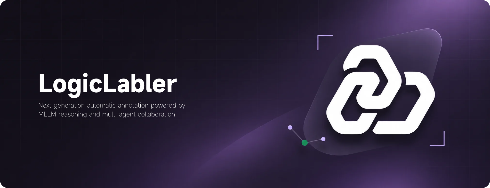
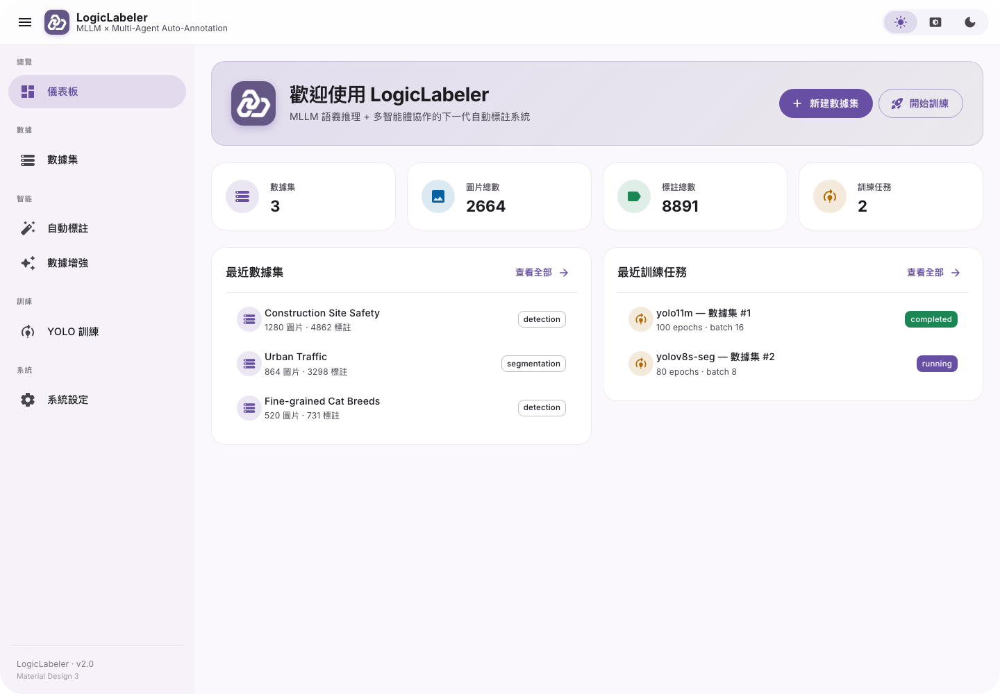
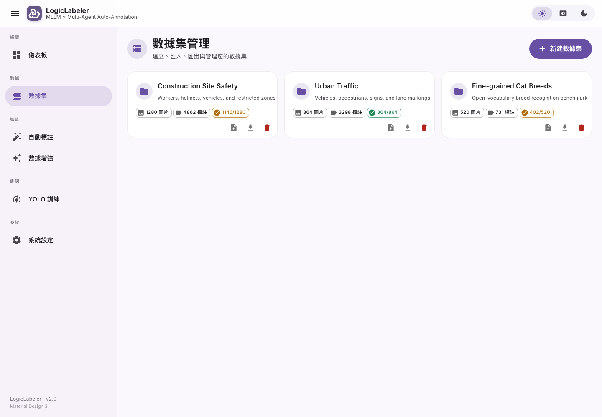
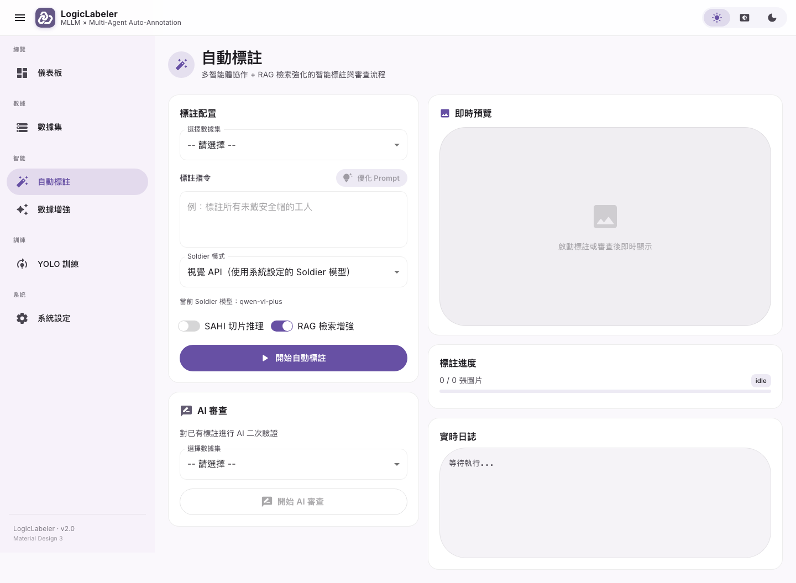
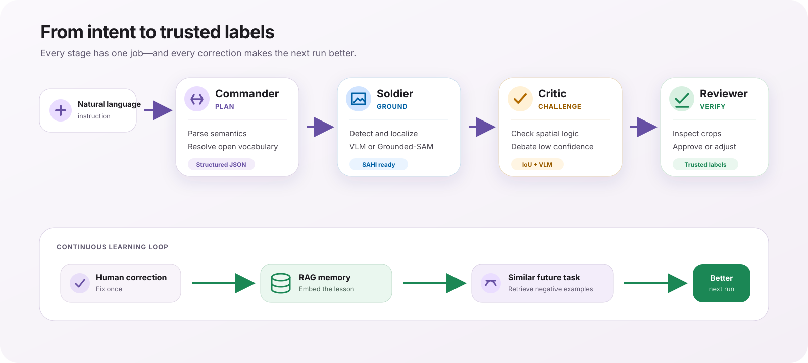
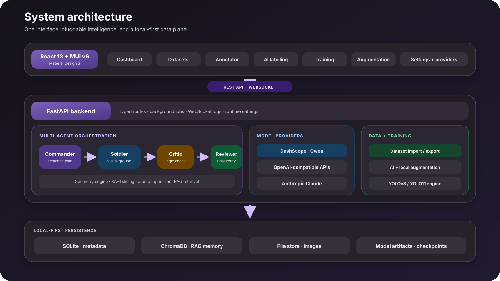
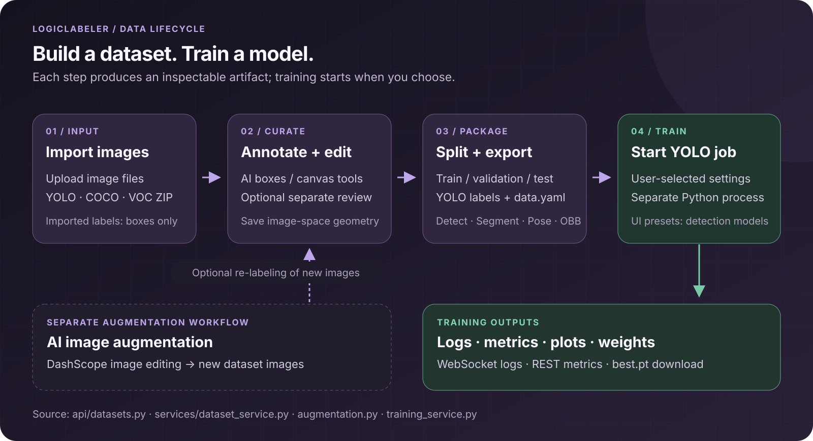

<div align="center">

[English](./README.md) · [繁體中文](./README.zh-TW.md) · **简体中文**


# LogicLabeler

**由 MLLM 推理和多智能体协作驱动的下一代自动标注工具**

*超越单纯识别物体——理解它们的关系、属性与状态。*

<br />



<br />


<a href="https://www.msc.org.mo/attachment/files/2026/06/18/第一屆“青年科技村科創人才培訓計劃”成果展得獎名單.pdf"></a>

<br /><br />

[获奖荣誉](#获奖荣誉) · [产品预览](#产品预览) · [标注流程](#多智能体标注流程) · [系统架构](#架构) · [数据生命周期](#从图片到模型产物) · [快速开始](#快速开始)

<br /><br />

| 传统标注 | LogicLabeler |
|:---:|:---:|
| “标注每个**工人**” | “标注所有**未戴安全帽的工人**” |
| “标注每辆**卡车**” | “标注所有**正在卸货的卡车**” |
| “标记每辆**车辆**” | “标记停在**限制区域内的车辆**” |

</div>

---

## 获奖荣誉

<a href="https://www.msc.org.mo/attachment/files/2026/06/18/第一屆“青年科技村科創人才培訓計劃”成果展得獎名單.pdf">
  
</a>

<p align="center"><sub>第一届“青年科技村”科创人才培训计划成果展 · <a href="https://www.msc.org.mo/attachment/files/2026/06/18/第一屆“青年科技村科創人才培訓計劃”成果展得獎名單.pdf">官方获奖名单</a></sub></p>

---

## 产品预览

### 仪表板



<table>
  <tr>
    <td width="50%">
      
      <p align="center"><b>数据集管理</b></p>
    </td>
    <td width="50%">
      
      <p align="center"><b>多智能体自动标注</b></p>
    </td>
  </tr>
</table>

---

## 为什么选择 LogicLabeler？

LogicLabeler 将指令驱动的检测、几何检查、人工标注编辑器、独立 AI 审查与 YOLO 训练整合到一个自托管工作区。以下内容依据本仓库的实际实现编写；模型输出仍需要人工判断。

| 挑战 | LogicLabeler 解决方案 |
|---|---|
| 昂贵的人工标注 | 批量自动化，仅在关键环节加入人工审查 |
| 标签不一致 | Critic 检查候选结果；独立 Reviewer 任务审查已保存的标注框 |
| 仅识别名词 | Commander 将指令转换为检测目标和几何规则 |
| 封闭类别列表 | 开放式词汇识别可分配细粒度类别名称 |
| 供应商锁定 | 支持 DashScope、OpenAI 兼容 API 及 Anthropic Claude |
| 工具互不相连 | 在单一平台上完成标注、数据增强、导出与 YOLO 训练 |

## 亮点

### 多智能体标注流程

批量标注执行 **Commander → Soldier → Critic → 保存**，可在规划前启用检索。**Reviewer 是用户单独启动的任务**，审查已经保存的标注。



| 组件 | 实际实现 | 源码 |
|---|---|---|
| Commander | 生成包含 `targets`、`examples`、`open_vocabulary`、`logic_rules` 和 `detection_prompts` 的 JSON；解析失败时回退到简单启发式计划 | [commander.py](./backend/app/services/commander.py) |
| Soldier | 调用所选 Soldier 视觉模型，或通过 `grounded_sam` 模式调用本地 Grounding DINO；返回像素坐标边界框 | [soldier.py](./backend/app/services/soldier.py) |
| Critic | 检查边界框几何关系、追加规则推导的标签，并使用裁剪图像调用视觉模型复核置信度低于 `0.5` 的候选结果 | [critic.py](./backend/app/services/critic.py)、[geometry.py](./backend/app/core/geometry.py) |
| 持久化 | 将每张已处理图片的标注替换为当前结果，并更新任务进度 | [labeling.py](./backend/app/api/labeling.py) |
| Reviewer | 独立审查已有边界框，记录 `approved`、`rejected` 或 `needs_adjustment`；应用结果会删除被拒绝的标注或修改建议类别，不会调整框的几何坐标 | [reviewer.py](./backend/app/services/reviewer.py) |

可选的 **SAHI 式切片推理**对重叠裁剪区域逐一检测，将边界框映射回原图并合并重复结果。单张图片辅助端点通过 Commander/Soldier 返回编辑器建议，不执行完整批处理流程。参见 [sahi_utils.py](./backend/app/core/sahi_utils.py) 和 [annotation_assist.py](./backend/app/api/annotation_assist.py)。

**当前实现边界：**尚无多轮智能体辩论。几何规则会追加匹配标签，而非移除所有不匹配的检测结果。`grounded_sam` 分支目前使用 Grounding DINO 边界框，不生成 SAM 掩码；需另行安装模型代码和权重，导入依赖失败时回退到视觉模型检测。

### 开放式词汇与细粒度识别

Commander 能区分范例与硬性约束。例如：

| 指令风格 | 解释 |
|---|---|
| "Cats **such as** British Shorthair, Ragdoll, or Siamese"（猫，例如英国短毛猫、布偶猫或暹罗猫） | 检测父类别 `cat`；使用品种作为提示；启用 `open_vocabulary` |
| "Detect **only** cat, dog, and person"（仅检测猫、狗和人） | 使用封闭类别列表；禁用 `open_vocabulary` |

当启用开放式词汇时，Soldier 可返回观察到的品种，而非强迫每个物体归入范例之一。不确定情况会使用类似 `cat (uncertain)`（猫 - 不确定）或 `cat (unknown breed)`（猫 - 未知品种）的标签。

### 专业标注工作区

- BBox、Polygon、Keypoint 和 Oriented BBox 工具
- 由 OpenCV GrabCut 驱动的 Smart Segment（智能分割）
- 当前图片的一键 AI 标注
- Loupe（放大镜）、像素网格、Mini-map、边缘吸附及按类别着色
- 撤销/重做、复制/贴上、锁定、键盘微调及多选编辑
- 每个标注属性：`occluded`（遮挡）、`truncated`（截断）、`blur`（模糊）和备注
- 每张图片的元数据：`verified`（已验证）、标签、备注及训练/验证/测试划分
- Keypoint schema（关键点模式）与骨架编辑器
- 自动导出 YOLO Detect、Segment、Pose 或 OBB

### Prompt 优化与增强

Prompt Optimizer 请求三种改写：更具体、加入逻辑及更精简。AI 数据增强调用 DashScope 的 `qwen-image-2.0-pro` 图像编辑 API，生成天气、光照和视角等变化。独立的数据增强流程可选择对生成图片运行 Commander → Soldier → Critic。本地 OpenCV/Pillow 增强会将变换后的图片和边界框加入数据集。参见[数据增强 API](./backend/app/api/augmentation.py) 和 [preprocessing.py](./backend/app/services/preprocessing.py)。

### YOLO 端到端训练

可从界面启动 YOLOv8 或 YOLO11 检测训练。每个任务会导出数据集并启动 Ultralytics 子进程。WebSocket 传输日志，REST 轮询提供图表所需指标。支持停止、取消、从 checkpoint 继续、产物浏览及最佳权重下载。界面目前列出的是检测模型变体；支持导出 Pose、Segment 或 OBB 标注，不代表已经配置对应的训练流程。

## 支持的功能

| 领域 | 能力 |
|---|---|
| 标注 (Annotation) | BBox, Polygon, Keypoint, OBB, Smart Segment |
| 导入 (Import) | YOLO、COCO、Pascal VOC ZIP；当前导入器读取边界框 |
| 导出 (Export) | YOLO Detect/Segment/Pose/OBB；尚未实现 COCO 导出 |
| 供应商 (Providers) | DashScope、OpenAI 兼容 API、Anthropic Claude |
| 本地检测 (Local detection) | 通过 `grounded_sam` 使用 Grounding DINO 边界框；可选裁剪切片推理 |
| 记忆 (Memory) | 可选 ChromaDB 文本检索；修正记录写入服务尚未接入编辑器保存流程 |
| 增强 (Augmentation) | AI 图像编辑，以及同步处理边界框的本地 OpenCV/Pillow 变换 |
| 训练 (Training) | YOLOv8 和 YOLO11（含生命周期控制） |
| 界面 (Interface) | React 18, MUI v6, Material Design 3, light/dark/system themes |

## 架构



### 运行架构与模型路由

| 层级 | 实现 | 源码 |
|---|---|---|
| 浏览器 | React 18 + TypeScript、MUI v6、React Router、Zustand；Canvas 标注编辑器与 Recharts 训练图表 | [frontend/src](./frontend/src)、[package.json](./frontend/package.json) |
| 网关 | Nginx 提供 Docker 构建后的静态页面，并代理 `/api`、`/ws` 和 `/static`；开发环境由 Vite 提供相应代理 | [nginx.conf](./frontend/nginx.conf)、[vite.config.ts](./frontend/vite.config.ts) |
| 应用 | FastAPI + Pydantic 路由、SQLAlchemy 会话；标注／审查运行于守护线程，训练运行于子进程 | [main.py](./backend/app/main.py)、[labeling.py](./backend/app/api/labeling.py)、[training_service.py](./backend/app/services/training_service.py) |
| 模型适配 | 三个可配置角色：`text` 负责规划／优化，`soldier` 负责检测，`vision` 用于 Critic/Reviewer；适配 DashScope、OpenAI 兼容及 Anthropic API | [model_providers.py](./backend/app/services/model_providers.py) |
| 实时更新 | 标注／审查状态与训练指标使用 REST 轮询；`/ws/logs/{job_id}` 流式传输训练日志 | [client.ts](./frontend/src/api/client.ts)、[ws.py](./backend/app/api/ws.py) |

执行视觉模型路径时，图片和裁剪区域会发送至所选供应商。本地 Grounding DINO 只负责检测；规划、复核及 AI 数据增强仍可能调用外部服务。供应商是否适用取决于所选模型的文本／图像能力，而不只是 API 是否兼容。

### 标注数据约定

编辑器、检测服务和数据库交换的坐标均采用**原图像素**。边界框以左上角为原点，而非中心点：

```json
{
  "class_name": "worker",
  "shape_type": "bbox",
  "bbox": { "x": 120, "y": 80, "w": 160, "h": 300 },
  "confidence": 0.92,
  "source": "manual"
}
```

这是标注数据示例，不是模型实测结果。多边形顶点和关键点也使用原图像素；OBB 存储中心、尺寸和角度。显示缩放／平移由画布变换处理。YOLO 导出将坐标转换为各任务对应的归一化标签行，并生成 `data.yaml`。Soldier 要求视觉模型返回像素坐标；适配层不会自动缩放供应商特有的归一化坐标。

源码：[API 类型](./frontend/src/api/client.ts)、[画布变换](./frontend/src/components/Annotator/AnnotationCanvas.tsx)、[数据库模型](./backend/app/models.py)、[导出实现](./backend/app/services/dataset_service.py)。

### 从图片到模型产物



1. **导入与编辑：**上传图片或导入边界框标注；在编辑器中添加边界框、多边形、关键点或旋转框。
2. **标注与检查：**运行批量检测或单图辅助，再人工检查结果或启动独立 Reviewer 任务。批量重新标注会覆盖已处理图片的现有标注，请先导出重要成果。
3. **划分与导出：**分配训练／验证／测试划分并导出 YOLO 标签。未设置划分时，导出器会让训练和验证使用相同图片，因此评估模型前应分配独立验证集。导入与导出支持范围不同：导入器读取边界框，导出器支持编辑器中的更多形状。
4. **主动启动训练：**训练任务准备数据、启动模型子进程，并记录日志、指标、checkpoint 及可用的 `best.pt`。完成标注不会自动启动训练或部署模型。

### 持久化与检索

| 存储 | 内容 | 生命周期 |
|---|---|---|
| SQLite | 数据集、图片元数据、标注、标注／审查／训练任务、供应商设置 | SQLAlchemy 表结构，启动时进行轻量列迁移 |
| `DATA_DIR` 下的文件系统 | `datasets/` 存储图片；`models/` 存储训练数据快照、日志和权重 | Docker 将主机 `./data` 挂载至 `/app/data`；导出 ZIP 按需在内存中构建并返回 |
| ChromaDB `error_memory` | 过往修正的文本描述及元数据 | 可在 Commander 之前按指令文本检索；失败时返回空上下文 |
| 进程内存 | 标注日志／当前图片预览、订阅者及任务执行句柄 | 不是持久任务队列；重启后端会中断进程内任务 |

RAG 服务提供 `store_correction()` 和 `retrieve_context()`，但**编辑器保存目前不会调用 `store_correction()`**。当前流程检索已有文本记录，并非自动视觉记忆或模型微调。参见 [rag_service.py](./backend/app/services/rag_service.py)、[database.py](./backend/app/database.py) 和 [models.py](./backend/app/models.py)。

回退逻辑会在模型失败时维持部分流程：Commander 可使用启发式计划，Soldier 可能返回空检测结果，Critic 在复核失败时保留候选结果。Reviewer 出错时可能回退为 `approved`，因此审查状态本身不能证明模型检查已成功执行。导出前应检查日志并抽查结果。

### 部署检查项

- **ChromaDB 端口：**Compose 映射为主机 `8100` → 容器 `8000`。后端到容器的连接必须使用 `chromadb:8000`；仓库中的 Compose 目前设置 `CHROMADB_PORT=8100`，需在后端的 `environment` 块中改为 `8000`，检索才能连接。本地运行的后端则使用 `localhost:8100`。
- **供应商前置条件：**即使选用其他供应商，批量标注和审查仍会检查是否配置 DashScope key。模型适配层支持上述三个角色；AI 数据增强专门使用 DashScope。
- **执行方式：**当前为单后端部署，使用线程／子进程任务，非分布式调度器。Docker 未配置 GPU 直通；本地检测权重及兼容硬件／运行环境需另行准备。
- **版本范围：**前端版本范围由 `package.json` 声明，`requirements.txt` 中的 Python 包未锁定版本，Compose 使用 `chromadb/chroma:latest`；徽章不代表经过测试的兼容性矩阵。

## 快速开始

### 环境要求

- [Docker](https://docs.docker.com/get-docker/) 和 [Docker Compose](https://docs.docker.com/compose/install/) v2+
- [DashScope API key](https://bailian.console.aliyun.com/?apiKey=1)：用于当前批量标注／审查的前置检查及 AI 数据增强。模型角色也可配置 OpenAI 兼容或 Anthropic 端点；检测与复核需选择支持图像输入的模型。
- 在 Docker 中使用检索时，请应用[部署检查项](#部署检查项)中的 ChromaDB 端口调整。

### 使用 Docker Compose 执行

```bash
git clone https://github.com/Roy24245/LogicLabeler-ai.git
cd LogicLabeler-ai

# 可选：在此处配置 key，或稍后在用户界面中输入。
cp .env.example .env

docker compose up --build -d
docker compose logs -f
```

服务准备就绪后：

| 服务 | 地址 |
|---|---|
| Web 界面 | <http://localhost> |
| Swagger API 文档 | <http://localhost:8000/docs> |
| ChromaDB | <http://localhost:8100> |

首次启动时，五步初始化向导会引导您完成外观、API key、模型供应商及当前使用模型的设置。

### 停止或重启

```bash
docker compose down
docker compose up -d
docker compose restart
```

## 本地开发

### 后端

```bash
cd backend
python3 -m venv venv
source venv/bin/activate
pip install -r requirements.txt

docker compose -f ../docker-compose.yml up chromadb -d
uvicorn app.main:app --reload --host 0.0.0.0 --port 8000
```

### 前端

```bash
cd frontend
npm install
npm run dev
```

Vite 开发服务器运行于 <http://localhost:3000>，将 `/api`、`/ws` 和 `/static` 代理到后端 `8000` 端口。本地运行后端时，使用 `CHROMADB_HOST=localhost` 和 `CHROMADB_PORT=8100`；配置中的路径相对于后端进程的工作目录。

## 配置

### 环境变量

| 变量 | 用途 | 默认值 |
|---|---|---|
| `DASHSCOPE_API_KEY` | DashScope API key | 可在界面中设置 |
| `DATABASE_URL` | SQLite 数据库地址 | `sqlite:///./data/logiclabeler.db` |
| `CHROMADB_HOST` | ChromaDB 主机名 | Docker 中为 `chromadb`，其他环境为 `localhost` |
| `CHROMADB_PORT` | ChromaDB 端口 | 本地为 `8100`；后端访问容器时设为 `8000` |
| `DATA_DIR` | 持久化数据根目录 | `./data` |

设置页面可在无需重启服务的情况下更新模型供应商、当前文本/视觉模型、Soldier 模式、数据增强、主题及初始化状态。

## 项目结构

```text
LogicLabeler-ai/
├── backend/
│   └── app/
│       ├── api/                 # REST 与 WebSocket 路由
│       ├── core/                # 几何与 SAHI 辅助工具
│       └── services/            # 智能体、供应商、RAG、数据与训练
├── frontend/
│   └── src/
│       ├── components/          # 共享界面与标注组件
│       ├── pages/               # 仪表板、数据集、标注、训练与设置
│       ├── api/                 # 类型化 API 客户端
│       └── store/               # Zustand 状态
├── data/                        # SQLite、数据集、模型与 ChromaDB 数据
├── docs/images/                 # 品牌视觉、截图与技术图解
├── docker-compose.yml
└── .env.example
```

## 主要 API 分组

后端启动后，可在 <http://localhost:8000/docs> 查看交互式文档。

| 分组 | 代表性端点 |
|---|---|
| 数据集 | `/api/datasets`、导入、导出、统计及划分操作 |
| 标注 | `/api/images/{id}/annotations` 及图片元数据 |
| AI 助手 | `/api/assist/segment`、`/api/assist/autolabel-image` |
| 自动标注 | `/api/labeling/run`、状态、审查及 Prompt Optimizer |
| 训练 | 启动、停止、继续、取消、指标、日志及产物 |
| 数据增强 | 启动增强及查询任务状态 |
| 设置 | 供应商、API keys、当前模型及健康检查 |

## 近期里程碑

- **2026.05 — 开放词汇：** Commander 可识别示例语句、Soldier 支持细粒度命名，并加入单张图片一键标注。
- **2026.04 — 标注工作区：** Polygon、Keypoint、OBB、Smart Segment、元数据、视觉辅助及扩展导出支持。
- **2026.03 — Material Design 3：** 全新主题系统、初始化向导、供应商管理、Prompt Optimizer 及完整训练生命周期控制。

## 授权条款

根据 [MIT License](./LICENSE) 发布。

Copyright (c) 2026 FONG, KUN FAI

---

<div align="center">

*Built with ❤️ using Qwen · OpenAI · Anthropic · React · FastAPI · ultralytics*

</div>
