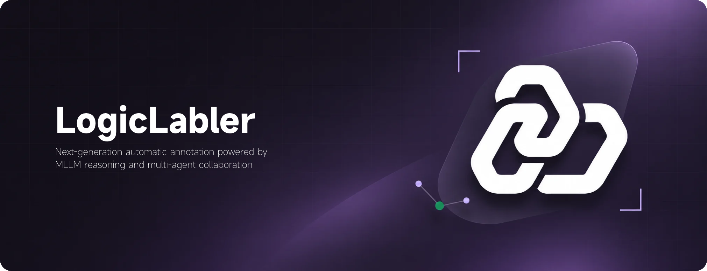
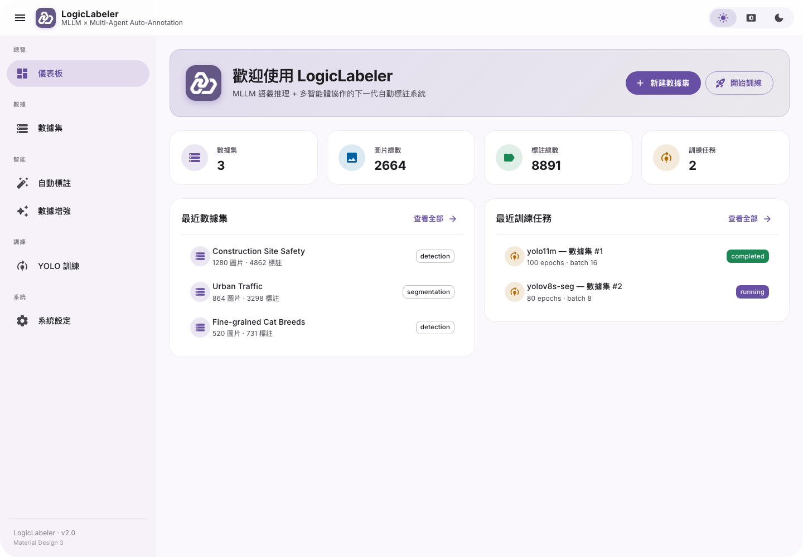
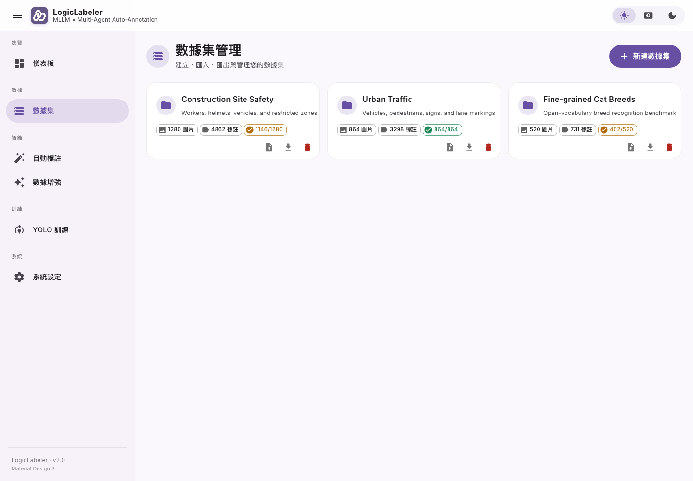
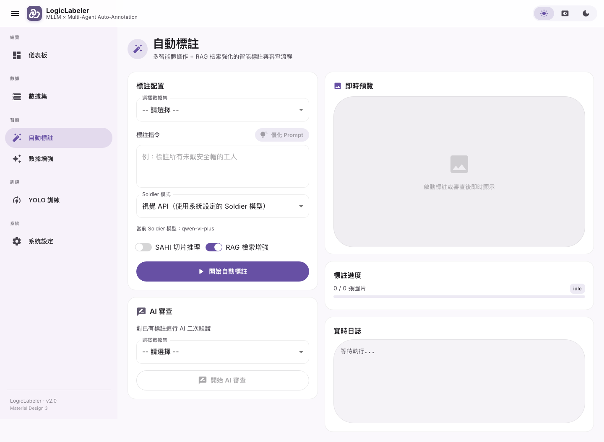
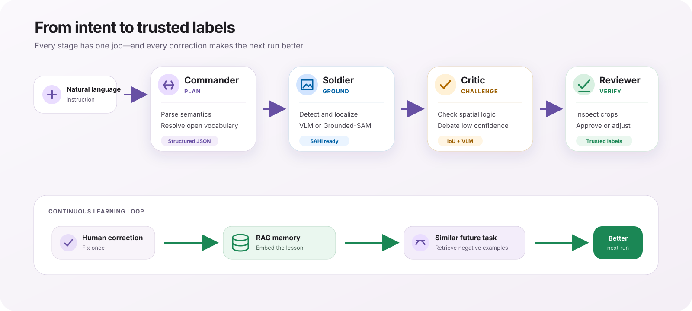
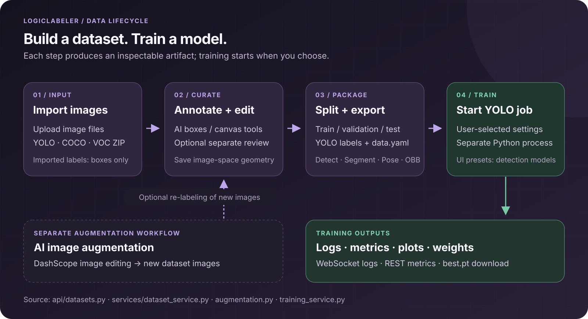

<div align="center">

[English](./README.md) · **繁體中文** · [简体中文](./README.zh-CN.md)


# LogicLabeler

**由 MLLM 推理和多智能體協作驅動的下一代自動標註工具**

*超越單純識別物體——理解它們的關係、屬性與狀態。*

<br />



<br />


<a href="https://www.msc.org.mo/attachment/files/2026/06/18/第一屆“青年科技村科創人才培訓計劃”成果展得獎名單.pdf"></a>

<br /><br />

[獎項肯定](#獎項肯定) · [產品預覽](#產品預覽) · [標註流程](#多智能體標註流程) · [系統架構](#架構) · [數據生命週期](#從圖片到模型產出) · [快速開始](#快速開始)

<br /><br />

| 傳統標註 | LogicLabeler |
|:---:|:---:|
| “標註每個**工人**” | “標註所有**未戴安全帽的工人**” |
| “標註每輛**卡車**” | “標註所有**正在卸貨的卡車**” |
| “標記每輛**車輛**” | “標記停在**限制區域內的車輛**” |

</div>

---

## 獎項肯定

<a href="https://www.msc.org.mo/attachment/files/2026/06/18/第一屆“青年科技村科創人才培訓計劃”成果展得獎名單.pdf">
  
</a>

<p align="center"><sub>第一屆「青年科技村」科創人才培訓計劃成果展 · <a href="https://www.msc.org.mo/attachment/files/2026/06/18/第一屆“青年科技村科創人才培訓計劃”成果展得獎名單.pdf">官方得獎名單</a></sub></p>

---

## 產品預覽

### 儀表板



<table>
  <tr>
    <td width="50%">
      
      <p align="center"><b>數據集管理</b></p>
    </td>
    <td width="50%">
      
      <p align="center"><b>多智能體自動標註</b></p>
    </td>
  </tr>
</table>

---

## 為什麼選擇 LogicLabeler？

LogicLabeler 將指令驅動的檢測、幾何檢查、人工標註編輯器、獨立 AI 審查與 YOLO 訓練整合到一個自託管工作區。以下內容依據本倉庫的實際實作編寫；模型輸出仍需要人工判斷。

| 挑戰 | LogicLabeler 解決方案 |
|---|---|
| 昂貴的人工標註 | 批量自動化，僅在關鍵處加入人工審查 |
| 標籤不一致 | Critic 檢查候選結果；獨立 Reviewer 任務審查已儲存的標註框 |
| 僅識別名詞 | Commander 將指令轉換為檢測目標和幾何規則 |
| 封閉類別列表 | 開放式詞彙識別可分配細粒度類別名稱 |
| 供應商鎖定 | 支援 DashScope、OpenAI 相容 API 及 Anthropic Claude |
| 工具互不相連 | 在單一平台上完成標註、數據增強、導出與 YOLO 訓練 |

## 亮點

### 多智能體標註流程

批量標註執行 **Commander → Soldier → Critic → 儲存**，可在規劃前啟用檢索。**Reviewer 是使用者單獨啟動的任務**，審查已經儲存的標註。



| 元件 | 實際實作 | 原始碼 |
|---|---|---|
| Commander | 產生包含 `targets`、`examples`、`open_vocabulary`、`logic_rules` 和 `detection_prompts` 的 JSON；解析失敗時退回簡單啟發式計畫 | [commander.py](./backend/app/services/commander.py) |
| Soldier | 呼叫所選 Soldier 視覺模型，或透過 `grounded_sam` 模式呼叫本地 Grounding DINO；返回像素座標邊界框 | [soldier.py](./backend/app/services/soldier.py) |
| Critic | 檢查邊界框幾何關係、追加規則推導的標籤，並使用裁剪圖像呼叫視覺模型複核信心值低於 `0.5` 的候選結果 | [critic.py](./backend/app/services/critic.py)、[geometry.py](./backend/app/core/geometry.py) |
| 持久化 | 將每張已處理圖片的標註替換為目前結果，並更新任務進度 | [labeling.py](./backend/app/api/labeling.py) |
| Reviewer | 獨立審查已有邊界框，記錄 `approved`、`rejected` 或 `needs_adjustment`；套用結果會刪除被拒絕的標註或修改建議類別，不會調整框的幾何座標 | [reviewer.py](./backend/app/services/reviewer.py) |

可選的 **SAHI 式切片推理**對重疊裁剪區域逐一檢測，將邊界框映射回原圖並合併重複結果。單張圖片輔助端點透過 Commander/Soldier 返回編輯器建議，不執行完整批次流程。參見 [sahi_utils.py](./backend/app/core/sahi_utils.py) 和 [annotation_assist.py](./backend/app/api/annotation_assist.py)。

**目前實作邊界：**尚無多輪智能體辯論。幾何規則會追加匹配標籤，而非移除所有不匹配的檢測結果。`grounded_sam` 分支目前使用 Grounding DINO 邊界框，不產生 SAM 遮罩；需另行安裝模型程式碼和權重，匯入依賴失敗時退回視覺模型檢測。

### 開放式詞彙與細粒度識別

Commander 能區分範例與硬性約束。例如：

| 指令風格 | 解釋 |
|---|---|
| "Cats **such as** British Shorthair, Ragdoll, or Siamese"（貓，例如英國短毛貓、布偶貓或暹羅貓） | 檢測父類別 `cat`；使用品種作為提示；啟用 `open_vocabulary` |
| "Detect **only** cat, dog, and person"（僅檢測貓、狗和人） | 使用封閉類別列表；禁用 `open_vocabulary` |

當啟用開放式詞彙時，Soldier 可返回觀察到的品種，而非強迫每個物體歸入範例之一。不確定情況會使用類似 `cat (uncertain)`（貓 - 不確定）或 `cat (unknown breed)`（貓 - 未知品種）的標籤。

### 專業標註工作區

- BBox、Polygon、Keypoint 和 Oriented BBox 工具
- 由 OpenCV GrabCut 驅動的 Smart Segment（智能分割）
- 目前圖片的一鍵 AI 標註
- Loupe（放大鏡）、像素網格、Mini-map、邊緣吸附及依類別著色
- 撤銷/重做、複製/貼上、鎖定、鍵盤微調及多選編輯
- 每個標註屬性：`occluded`（遮擋）、`truncated`（截斷）、`blur`（模糊）和備註
- 每張圖片的元數據：`verified`（已驗證）、標籤、備註及訓練/驗證/測試分割
- Keypoint schema（關鍵點模式）與骨架編輯器
- 自動導出 YOLO Detect、Segment、Pose 或 OBB

### Prompt 優化與增強

Prompt Optimizer 請求三種改寫：更具體、加入邏輯及更精簡。AI 數據增強呼叫 DashScope 的 `qwen-image-2.0-pro` 圖像編輯 API，產生天氣、光照和視角等變化。獨立的數據增強流程可選擇對產生圖片執行 Commander → Soldier → Critic。本地 OpenCV/Pillow 增強會將變換後的圖片和邊界框加入數據集。參見[數據增強 API](./backend/app/api/augmentation.py) 和 [preprocessing.py](./backend/app/services/preprocessing.py)。

### YOLO 端到端訓練

可從介面啟動 YOLOv8 或 YOLO11 檢測訓練。每個任務會導出數據集並啟動 Ultralytics 子程序。WebSocket 傳輸日誌，REST 輪詢提供圖表所需指標。支援停止、取消、從 checkpoint 繼續、產出瀏覽及最佳權重下載。介面目前列出的是檢測模型變體；支援導出 Pose、Segment 或 OBB 標註，不代表已經設定對應的訓練流程。

## 支援能力

| 領域 | 能力 |
|---|---|
| 標註 (Annotation) | BBox, Polygon, Keypoint, OBB, Smart Segment |
| 導入 (Import) | YOLO、COCO、Pascal VOC ZIP；目前導入器讀取邊界框 |
| 導出 (Export) | YOLO Detect/Segment/Pose/OBB；尚未實作 COCO 導出 |
| 供應商 (Providers) | DashScope, OpenAI-compatible APIs, Anthropic Claude |
| 本地檢測 (Local detection) | 透過 `grounded_sam` 使用 Grounding DINO 邊界框；可選裁剪切片推理 |
| 記憶 (Memory) | 可選 ChromaDB 文字檢索；修正記錄寫入服務尚未接入編輯器儲存流程 |
| 增強 (Augmentation) | AI 圖像編輯，以及同步處理邊界框的本地 OpenCV/Pillow 變換 |
| 訓練 (Training) | YOLOv8 和 YOLO11（含生命週期控制） |
| 介面 (Interface) | React 18, MUI v6, Material Design 3, light/dark/system themes |

## 架構


### 執行架構與模型路由

| 層級 | 實作 | 原始碼 |
|---|---|---|
| 瀏覽器 | React 18 + TypeScript、MUI v6、React Router、Zustand；Canvas 標註編輯器與 Recharts 訓練圖表 | [frontend/src](./frontend/src)、[package.json](./frontend/package.json) |
| 閘道 | Nginx 提供 Docker 建置後的靜態頁面，並代理 `/api`、`/ws` 和 `/static`；開發環境由 Vite 提供相應代理 | [nginx.conf](./frontend/nginx.conf)、[vite.config.ts](./frontend/vite.config.ts) |
| 應用 | FastAPI + Pydantic 路由、SQLAlchemy 工作階段；標註／審查執行於背景執行緒，訓練執行於子程序 | [main.py](./backend/app/main.py)、[labeling.py](./backend/app/api/labeling.py)、[training_service.py](./backend/app/services/training_service.py) |
| 模型適配 | 三個可設定角色：`text` 負責規劃／優化，`soldier` 負責檢測，`vision` 用於 Critic/Reviewer；適配 DashScope、OpenAI 相容及 Anthropic API | [model_providers.py](./backend/app/services/model_providers.py) |
| 即時更新 | 標註／審查狀態與訓練指標使用 REST 輪詢；`/ws/logs/{job_id}` 串流傳輸訓練日誌 | [client.ts](./frontend/src/api/client.ts)、[ws.py](./backend/app/api/ws.py) |

執行視覺模型路徑時，圖片和裁剪區域會傳送至所選供應商。本地 Grounding DINO 只負責檢測；規劃、複核及 AI 數據增強仍可能呼叫外部服務。供應商是否適用取決於所選模型的文字／圖像能力，而不只是 API 是否相容。

### 標註數據約定

編輯器、檢測服務和資料庫交換的座標均採用**原圖像素**。邊界框以左上角為原點，而非中心點：

```json
{
  "class_name": "worker",
  "shape_type": "bbox",
  "bbox": { "x": 120, "y": 80, "w": 160, "h": 300 },
  "confidence": 0.92,
  "source": "manual"
}
```

這是標註數據範例，不是模型實測結果。多邊形頂點和關鍵點也使用原圖像素；OBB 儲存中心、尺寸和角度。顯示縮放／平移由畫布變換處理。YOLO 導出將座標轉換為各任務對應的正規化標籤列，並產生 `data.yaml`。Soldier 要求視覺模型返回像素座標；適配層不會自動縮放供應商特有的正規化座標。

原始碼：[API 型別](./frontend/src/api/client.ts)、[畫布變換](./frontend/src/components/Annotator/AnnotationCanvas.tsx)、[資料庫模型](./backend/app/models.py)、[導出實作](./backend/app/services/dataset_service.py)。

### 從圖片到模型產出



1. **導入與編輯：**上傳圖片或導入邊界框標註；在編輯器中加入邊界框、多邊形、關鍵點或旋轉框。
2. **標註與檢查：**執行批量檢測或單圖輔助，再人工檢查結果或啟動獨立 Reviewer 任務。批量重新標註會覆蓋已處理圖片的現有標註，請先導出重要成果。
3. **分割與導出：**分配訓練／驗證／測試分割並導出 YOLO 標籤。未設定分割時，導出器會讓訓練和驗證使用相同圖片，因此評估模型前應分配獨立驗證集。導入與導出支援範圍不同：導入器讀取邊界框，導出器支援編輯器中的更多形狀。
4. **主動啟動訓練：**訓練任務準備數據、啟動模型子程序，並記錄日誌、指標、checkpoint 及可用的 `best.pt`。完成標註不會自動啟動訓練或部署模型。

### 持久化與檢索

| 儲存 | 內容 | 生命週期 |
|---|---|---|
| SQLite | 數據集、圖片元數據、標註、標註／審查／訓練任務、供應商設定 | SQLAlchemy 表格結構，啟動時進行輕量欄位遷移 |
| `DATA_DIR` 下的檔案系統 | `datasets/` 儲存圖片；`models/` 儲存訓練數據快照、日誌和權重 | Docker 將主機 `./data` 掛載至 `/app/data`；導出 ZIP 按需在記憶體中建立並返回 |
| ChromaDB `error_memory` | 過往修正的文字描述及元數據 | 可在 Commander 之前按指令文字檢索；失敗時返回空上下文 |
| 程序記憶體 | 標註日誌／目前圖片預覽、訂閱者及任務執行控制代碼 | 不是持久任務佇列；重啟後端會中斷程序內任務 |

RAG 服務提供 `store_correction()` 和 `retrieve_context()`，但**編輯器儲存目前不會呼叫 `store_correction()`**。目前流程檢索已有文字記錄，並非自動視覺記憶或模型微調。參見 [rag_service.py](./backend/app/services/rag_service.py)、[database.py](./backend/app/database.py) 和 [models.py](./backend/app/models.py)。

回退邏輯會在模型失敗時維持部分流程：Commander 可使用啟發式計畫，Soldier 可能返回空檢測結果，Critic 在複核失敗時保留候選結果。Reviewer 出錯時可能退回 `approved`，因此審查狀態本身不能證明模型檢查已成功執行。導出前應檢查日誌並抽查結果。

### 部署檢查項目

- **ChromaDB 連接埠：**Compose 映射為主機 `8100` → 容器 `8000`。後端到容器的連線必須使用 `chromadb:8000`；倉庫中的 Compose 目前設定 `CHROMADB_PORT=8100`，需在後端的 `environment` 區塊中改為 `8000`，檢索才能連線。本地執行的後端則使用 `localhost:8100`。
- **供應商前置條件：**即使選用其他供應商，批量標註和審查仍會檢查是否設定 DashScope key。模型適配層支援上述三個角色；AI 數據增強專門使用 DashScope。
- **執行方式：**目前為單後端部署，使用執行緒／子程序任務，非分散式排程器。Docker 未設定 GPU 直通；本地檢測權重及相容硬體／執行環境需另行準備。
- **版本範圍：**前端版本範圍由 `package.json` 宣告，`requirements.txt` 中的 Python 套件未鎖定版本，Compose 使用 `chromadb/chroma:latest`；徽章不代表經過測試的相容性矩陣。

## 快速開始

### 需求條件

- [Docker](https://docs.docker.com/get-docker/) 和 [Docker Compose](https://docs.docker.com/compose/install/) v2+
- [DashScope API key](https://bailian.console.aliyun.com/?apiKey=1)：用於目前批量標註／審查的前置檢查及 AI 數據增強。模型角色也可設定 OpenAI 相容或 Anthropic 端點；檢測與複核需選擇支援圖像輸入的模型。
- 在 Docker 中使用檢索時，請套用[部署檢查項目](#部署檢查項目)中的 ChromaDB 連接埠調整。

### 使用 Docker Compose 執行

```bash
git clone https://github.com/Roy24245/LogicLabeler-ai.git
cd LogicLabeler-ai

# 選用：在此處設定 key，或稍後在使用者介面中輸入。
cp .env.example .env

docker compose up --build -d
docker compose logs -f
```

服務準備就緒後：

| 服務 | 網址 |
|---|---|
| Web 介面 | <http://localhost> |
| Swagger API 文件 | <http://localhost:8000/docs> |
| ChromaDB | <http://localhost:8100> |

首次啟動時，五步驟初始化精靈會引導您完成外觀、API key、模型供應商及目前使用模型的設定。

### 停止或重啟

```bash
docker compose down
docker compose up -d
docker compose restart
```

## 本地開發

### 後端

```bash
cd backend
python3 -m venv venv
source venv/bin/activate
pip install -r requirements.txt

docker compose -f ../docker-compose.yml up chromadb -d
uvicorn app.main:app --reload --host 0.0.0.0 --port 8000
```

### 前端

```bash
cd frontend
npm install
npm run dev
```

Vite 開發伺服器執行於 <http://localhost:3000>，將 `/api`、`/ws` 和 `/static` 代理至後端 `8000` 埠。本地執行後端時，使用 `CHROMADB_HOST=localhost` 和 `CHROMADB_PORT=8100`；設定中的路徑相對於後端程序的工作目錄。

## 設定

### 環境變數

| 變數 | 用途 | 預設值 |
|---|---|---|
| `DASHSCOPE_API_KEY` | DashScope API key | 可在介面中設定 |
| `DATABASE_URL` | SQLite 數據庫網址 | `sqlite:///./data/logiclabeler.db` |
| `CHROMADB_HOST` | ChromaDB 主機名稱 | Docker 中為 `chromadb`，其他環境為 `localhost` |
| `CHROMADB_PORT` | ChromaDB 連接埠 | 本地為 `8100`；後端存取容器時設為 `8000` |
| `DATA_DIR` | 持久化數據根目錄 | `./data` |

設定頁面可在無需重啟服務的情況下更新模型供應商、目前文字/視覺模型、Soldier 模式、數據增強、主題及初始化狀態。

## 專案結構

```text
LogicLabeler-ai/
├── backend/
│   └── app/
│       ├── api/                 # REST 與 WebSocket 路由
│       ├── core/                # 幾何與 SAHI 輔助工具
│       └── services/            # 智能體、供應商、RAG、數據與訓練
├── frontend/
│   └── src/
│       ├── components/          # 共用介面與標註元件
│       ├── pages/               # 儀表板、數據集、標註、訓練與設定
│       ├── api/                 # 型別化 API 用戶端
│       └── store/               # Zustand 狀態
├── data/                        # SQLite、數據集、模型與 ChromaDB 數據
├── docs/images/                 # 品牌視覺、截圖與技術圖解
├── docker-compose.yml
└── .env.example
```

## 主要 API 群組

後端啟動後，互動式文件可在 <http://localhost:8000/docs> 取得。

| 群組 | 代表性端點 |
|---|---|
| 數據集 | `/api/datasets`、導入、導出、統計及分割操作 |
| 標註 | `/api/images/{id}/annotations` 及圖片元數據 |
| AI 助手 | `/api/assist/segment`、`/api/assist/autolabel-image` |
| 自動標註 | `/api/labeling/run`、狀態、審查及 Prompt Optimizer |
| 訓練 | 啟動、停止、繼續、取消、指標、日誌及產出 |
| 數據增強 | 啟動增強及查詢任務狀態 |
| 設定 | 供應商、API keys、目前模型及健康檢查 |

## 近期里程碑

- **2026.05 — 開放詞彙：** Commander 可辨識範例語句、Soldier 支援細粒度命名，並加入單張圖片一鍵標註。
- **2026.04 — 標註工作區：** Polygon、Keypoint、OBB、Smart Segment、元數據、視覺輔助及更完整的導出支援。
- **2026.03 — Material Design 3：** 全新主題系統、初始化精靈、供應商管理、Prompt Optimizer 及完整訓練生命週期控制。

## 授權條款

根據 [MIT License](./LICENSE) 發布。

Copyright (c) 2026 FONG, KUN FAI

---

<div align="center">

*Built with ❤️ using Qwen · OpenAI · Anthropic · React · FastAPI · ultralytics*

</div>
