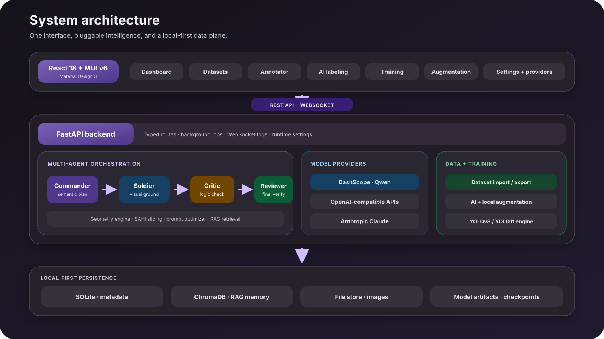

<div align="center">

[English](./README.md) · **繁體中文** · [简体中文](./README.zh-CN.md)


# LogicLabeler

**由 MLLM 推理和多智能體協作驅動的下一代自動標註工具**

*超越單純識別物體——理解它們的關係、屬性與狀態。*

<br />


<br />


<a href="https://www.msc.org.mo/attachment/files/2026/06/18/第一屆“青年科技村科創人才培訓計劃”成果展得獎名單.pdf"></a>

<br /><br />

[獎項肯定](#獎項肯定) · [為什麼選擇 LogicLabeler？](#為什麼選擇-logiclabeler) · [標註流程](#多智能體標註流程) · [產品預覽](#產品預覽) · [快速開始](#快速開始) · [系統架構](#架構)

<br /><br />

| 傳統標註 | LogicLabeler |
|:---:|:---:|
| “標註每個**工人**” | “標註所有**未戴安全帽的工人**” |
| “標註每輛**卡車**” | “標註所有**正在卸貨的卡車**” |
| “標記每輛**車輛**” | “標記停在**限制區域內的車輛**” |

</div>

---

## 獎項肯定

<a href="https://www.msc.org.mo/attachment/files/2026/06/18/第一屆“青年科技村科創人才培訓計劃”成果展得獎名單.pdf">
  
</a>

<p align="center"><sub>第一屆「青年科技村」科創人才培訓計劃成果展 · <a href="https://www.msc.org.mo/attachment/files/2026/06/18/第一屆“青年科技村科創人才培訓計劃”成果展得獎名單.pdf">官方得獎名單</a></sub></p>

---

## 產品預覽

### 儀表板


<table>
  <tr>
    <td width="50%">
      
      <p align="center"><b>數據集管理</b></p>
    </td>
    <td width="50%">
      
      <p align="center"><b>多智能體自動標註</b></p>
    </td>
  </tr>
</table>

---

## 為什麼選擇 LogicLabeler？

高品質標註數據仍是 AI 系統落地時最大的瓶頸之一。LogicLabeler 將語義規劃、視覺檢測、對抗式審查、人工修正與模型訓練整合成單一自託管工作流程。

| 挑戰 | LogicLabeler 解決方案 |
|---|---|
| 昂貴的人工標註 | 批量自動化，僅在關鍵處加入人工審查 |
| 標籤不一致 | Critic（批評者）和 Reviewer（審閱者）智能體驗證幾何與語義約束 |
| 僅識別名詞 | Chain-of-Thought（思維鏈）規劃支援複合邏輯指令 |
| 封閉類別列表 | 開放式詞彙識別可分配細粒度類別名稱 |
| 供應商鎖定 | 支援 DashScope、OpenAI 相容 API 及 Anthropic Claude |
| 工具互不相連 | 在單一平台上完成標註、數據增強、導出與 YOLO 訓練 |

## 亮點

### 多智能體標註流程

LogicLabeler 採用四階段工作流程：


1. **Commander（指揮官）** 解析自然語言指令並建立結構化計畫。
2. **Soldier（士兵）** 使用視覺模型或本地 Grounded-SAM 推理檢測物體。
3. **Critic（批評者）** 驗證幾何與語義約束，並可觸發多輪辯論。
4. **Reviewer（審閱者）** 檢查個別裁剪圖片，提出核准、拒絕或標註框調整建議。

人工修正會向量化存入 ChromaDB，並在之後遇到相似任務時作為負例自動檢索。

### 開放式詞彙與細粒度識別

Commander 能區分範例與硬性約束。例如：

| 指令風格 | 解釋 |
|---|---|
| "Cats **such as** British Shorthair, Ragdoll, or Siamese"（貓，例如英國短毛貓、布偶貓或暹羅貓） | 檢測父類別 `cat`；使用品種作為提示；啟用 `open_vocabulary` |
| "Detect **only** cat, dog, and person"（僅檢測貓、狗和人） | 使用封閉類別列表；禁用 `open_vocabulary` |

當啟用開放式詞彙時，Soldier 可返回觀察到的品種，而非強迫每個物體歸入範例之一。不確定情況會使用類似 `cat (uncertain)`（貓 - 不確定）或 `cat (unknown breed)`（貓 - 未知品種）的標籤。

### 專業標註工作區

- BBox、Polygon、Keypoint 和 Oriented BBox 工具
- 由 OpenCV GrabCut 驅動的 Smart Segment（智能分割）
- 目前圖片的一鍵 AI 標註
- Loupe（放大鏡）、像素網格、Mini-map、邊緣吸附及依類別著色
- 撤銷/重做、複製/貼上、鎖定、鍵盤微調及多選編輯
- 每個標註屬性：`occluded`（遮擋）、`truncated`（截斷）、`blur`（模糊）和備註
- 每張圖片的元數據：`verified`（已驗證）、標籤、備註及訓練/驗證/測試分割
- Keypoint schema（關鍵點模式）與骨架編輯器
- 自動導出 YOLO Detect、Segment、Pose 或 OBB

### Prompt 優化與增強

內建 Prompt Optimizer 可產生三種版本：更具體、加入邏輯及更精簡。AI 數據增強使用 `qwen-image-2.0-pro` 產生天氣、光照與視角等語義一致的變體，再將新圖片送入完整標註流程。

### YOLO 端到端訓練

無需離開應用程式即可訓練 YOLOv8 或 YOLO11。訓練功能包含 WebSocket 日誌、即時圖表、從 checkpoint 繼續、停止/取消控制、訓練產出瀏覽及最佳權重下載。

## 支援能力

| 領域 | 能力 |
|---|---|
| 標註 (Annotation) | BBox, Polygon, Keypoint, OBB, Smart Segment |
| 導入 (Import) | YOLO, COCO, Pascal VOC ZIP |
| 導出 (Export) | YOLO Detect/Segment/Pose/OBB 和 COCO |
| 供應商 (Providers) | DashScope, OpenAI-compatible APIs, Anthropic Claude |
| 本地檢測 (Local detection) | Grounded-SAM（可選 SAHI slicing） |
| 記憶 (Memory) | 從人工修正中檢索 ChromaDB 記憶 |
| 增強 (Augmentation) | AI 圖像編輯加上 OpenCV/Pillow 預處理 |
| 訓練 (Training) | YOLOv8 和 YOLO11（含生命週期控制） |
| 介面 (Interface) | React 18, MUI v6, Material Design 3, light/dark/system themes |

## 架構



## 快速開始

### 需求條件

- [Docker](https://docs.docker.com/get-docker/) 和 [Docker Compose](https://docs.docker.com/compose/install/) v2+
- 至少一個支援的模型供應商 API key：
  - [DashScope](https://bailian.console.aliyun.com/?apiKey=1)（預設，亦用於 AI 數據增強）
  - 或 OpenAI 相容 API、Anthropic、DeepSeek、OpenRouter、Ollama 或 vLLM 端點

### 使用 Docker Compose 執行

```bash
git clone https://github.com/Roy24245/LogicLabeler-ai.git
cd LogicLabeler-ai

# 選用：在此處設定 key，或稍後在使用者介面中輸入。
cp .env.example .env

docker compose up --build -d
docker compose logs -f
```

服務準備就緒後：

| 服務 | 網址 |
|---|---|
| Web 介面 | <http://localhost> |
| Swagger API 文件 | <http://localhost:8000/docs> |
| ChromaDB | <http://localhost:8100> |

首次啟動時，五步驟初始化精靈會引導您完成外觀、API key、模型供應商及目前使用模型的設定。

### 停止或重啟

```bash
docker compose down
docker compose up -d
docker compose restart
```

## 本地開發

### 後端

```bash
cd backend
python3 -m venv venv
source venv/bin/activate
pip install -r requirements.txt

docker compose up chromadb -d
uvicorn app.main:app --reload --host 0.0.0.0 --port 8000
```

### 前端

```bash
cd frontend
npm install
npm run dev
```

Vite 開發伺服器將 `/api` 代理至後端 `8000` 埠。

## 設定

### 環境變數

| 變數 | 用途 | 預設值 |
|---|---|---|
| `DASHSCOPE_API_KEY` | DashScope API key | 可在介面中設定 |
| `DATABASE_URL` | SQLite 數據庫網址 | `sqlite:///./data/logiclabeler.db` |
| `CHROMADB_HOST` | ChromaDB 主機名稱 | Docker 中為 `chromadb`，其他環境為 `localhost` |
| `CHROMADB_PORT` | ChromaDB 連接埠 | `8100` |
| `DATA_DIR` | 持久化數據根目錄 | `./data` |

設定頁面可在無需重啟服務的情況下更新模型供應商、目前文字/視覺模型、Soldier 模式、數據增強、主題及初始化狀態。

## 專案結構

```text
LogicLabeler-ai/
├── backend/
│   └── app/
│       ├── api/                 # REST 與 WebSocket 路由
│       ├── core/                # 幾何與 SAHI 輔助工具
│       └── services/            # 智能體、供應商、RAG、數據與訓練
├── frontend/
│   └── src/
│       ├── components/          # 共用介面與標註元件
│       ├── pages/               # 儀表板、數據集、標註、訓練與設定
│       ├── api/                 # 型別化 API 用戶端
│       └── store/               # Zustand 狀態
├── data/                        # SQLite、數據集、模型與 ChromaDB 數據
├── docs/images/                 # README 視覺資產
├── docker-compose.yml
└── .env.example
```

## 主要 API 群組

後端啟動後，互動式文件可在 <http://localhost:8000/docs> 取得。

| 群組 | 代表性端點 |
|---|---|
| 數據集 | `/api/datasets`、導入、導出、統計及分割操作 |
| 標註 | `/api/images/{id}/annotations` 及圖片元數據 |
| AI 助手 | `/api/assist/segment`、`/api/assist/autolabel-image` |
| 自動標註 | `/api/labeling/run`、狀態、審查及 Prompt Optimizer |
| 訓練 | 啟動、停止、繼續、取消、指標、日誌及產出 |
| 數據增強 | 啟動增強及查詢任務狀態 |
| 設定 | 供應商、API keys、目前模型及健康檢查 |

## 近期里程碑

- **2026.05 — 開放詞彙：** Commander 可辨識範例語句、Soldier 支援細粒度命名，並加入單張圖片一鍵標註。
- **2026.04 — 標註工作區：** Polygon、Keypoint、OBB、Smart Segment、元數據、視覺輔助及更完整的導出支援。
- **2026.03 — Material Design 3：** 全新主題系統、初始化精靈、供應商管理、Prompt Optimizer 及完整訓練生命週期控制。

## 授權條款

根據 [MIT License](./LICENSE) 發布。

Copyright (c) 2026 FONG, KUN FAI

---

<div align="center">

*Built with ❤️ using Qwen · OpenAI · Anthropic · React · FastAPI · ultralytics*

</div>
